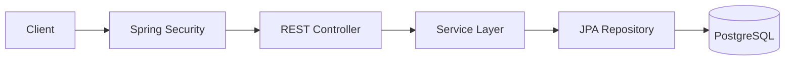

# Java Learning Platform

A personal backend project for an e-learning platform, focused on REST API design, relational data modeling, authentication and role-based authorization.

**Status:** Active development · Backend API

## Features

- Course management: CRUD and keyword search.
- Chapter and lesson management within a course hierarchy.
- User registration, login and profile retrieval.
- BCrypt password hashing.
- JWT access and refresh token generation using HS256.
- JWT validation with Spring Security OAuth2 Resource Server and a custom token-type validator.
- Role-based access control (ADMIN and USER) using method-level authorization.
- Interactive API documentation with Swagger UI.

## Tech stack

Java 25 · Spring Boot 4.1.1 · Spring MVC · Spring Data JPA / Hibernate · PostgreSQL · Spring Security · Maven · Lombok · Springdoc OpenAPI

## Architecture



The domain model includes `Course → Chapter → Lesson` and `User → UserHasRole → Role`. Request and response DTOs are separated from persistence entities.

## API overview

| Method | Endpoint | Access |
| --- | --- | --- |
| POST | `/auth/register` | Public |
| POST | `/auth/login` | Public |
| GET | `/api/courses` | Authenticated |
| GET | `/api/courses/search?keyword=...` | Authenticated |
| GET | `/api/chapters/course/{courseId}` | Authenticated |
| GET | `/api/lessons/chapter/{chapterId}` | Authenticated |
| POST | `/api/courses` | ADMIN |
| GET | `/users/myInfo` | Authenticated |
| GET | `/users` | ADMIN |

Creating, updating and deleting courses, chapters and lessons requires ADMIN authority. Access tokens expire after 30 minutes; refresh tokens expire after 30 days. Refresh tokens are intended to be rejected when used as API bearer tokens.

## Getting started

Requirements: JDK 25, Maven and PostgreSQL.

1. Clone the repository:

   ```bash
   git clone https://github.com/jackquannguyen/java-learning-platform.git
   cd java-learning-platform
   ```

2. Create an empty PostgreSQL database, for example `java_learning`.

3. Set the required environment variables (PowerShell example):

   ```powershell
   $env:DB_DRIVER_URL = "jdbc:postgresql://localhost:5432/java_learning"
   $env:DB_USERNAME = "your_local_db_user"
   $env:DB_PASSWORD = "your_local_db_password"
   $env:JWT_SECRET_KEY = "replace-with-a-random-secret-at-least-32-bytes"
   ```

   Replace the placeholders with local credentials and a strong random secret. Never commit actual credentials.

4. Start the application:

   ```bash
   mvn -Pdev spring-boot:run
   ```

5. After Hibernate creates the development database schema, initialize the required roles in PostgreSQL:

   ```sql
   INSERT INTO roles (name, description)
   VALUES ('USER', 'Standard user'), ('ADMIN', 'Administrator')
   ON CONFLICT (name) DO NOTHING;
   ```

6. Open [Swagger UI](http://localhost:8080/swagger-ui/index.html). Register a test user, log in and send the returned access token as an `Authorization: Bearer <access_token>` header for authenticated requests.

These setup instructions follow the current development configuration. A clean installation has not yet been verified.

## Project structure

```text
src/main/java/com/javabuilder/backendservice/
├── common/          Shared enums
├── configuration/   Security and JWT validation
├── controller/      REST endpoints
├── dto/             Request and response models
├── entity/          JPA domain entities
├── mapper/          Entity-to-DTO mapping
├── repository/      Persistence interfaces
└── service/         Business logic and authentication
src/main/resources/  Application profiles
src/test/java/       Test sources
```

## Current scope and next steps

- Refresh token issuance is implemented; token renewal is not yet exposed as an API endpoint.
- Lesson access currently requires authentication; enrollment-based content authorization is not implemented.
- Testing currently consists of a Spring context-load test. Dedicated unit and integration tests are planned.
- Production and test configuration, Docker, CI/CD and deployment remain future work.

This project is a learning and portfolio application, not a production service.
